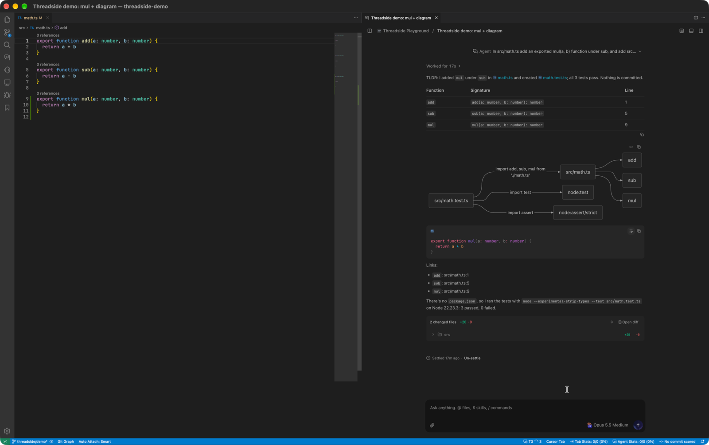
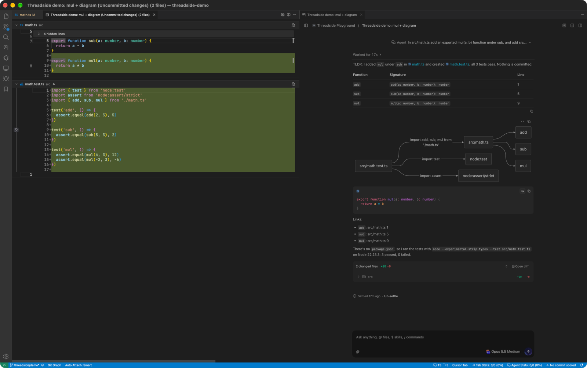
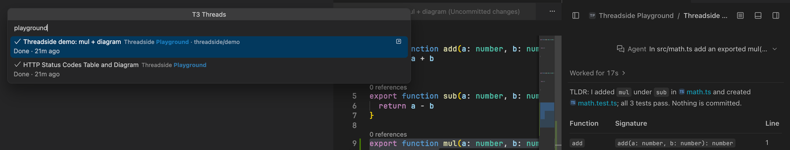

# Threadside: T3 Code chat for Cursor and VS Code

> **Unofficial.** Threadside is a community extension. It is not made, endorsed or supported by T3 Tools Inc. or the T3 Code team. It needs your own [T3 Code](https://github.com/pingdotgg/t3code) server and works with no Cursor or AI subscription of its own.

Threadside docks T3 Code's chat on the right of your editor, where Cursor's chat sits, and wires it into the editor: file links open at the right line in your code column, the selection or the current file becomes context with one shortcut, and a thread's changes open in the editor's diff view.

The chat is T3 Code's own web app, served by your server, so every provider, account, worktree, side chat, device and setting T3 Code has is already there, and it updates when your server does.



## What you get

- **The full T3 Code chat, docked on the right.** On first run the chat moves to the Secondary Side Bar, next to Cursor's own agent, and stays there across files and windows, in the editor's theme, background and fonts. <kbd>⌘I</kbd> shows or hides it and <kbd>⌘W</kbd> closes it (after a terminal or panel open in T3 Code), <kbd>⌘,</kbd> or <kbd>⌘.</kbd> opens T3 Code's Settings; the title bar has **New Thread**, **Search Threads** and **Open in Editor Tab**. A new chat starts in the T3 project whose folder is the window's folder (else the project of the file you are editing; a repository T3 Code does not know yet is added as a project first), and the chat shows as soon as a window opens, in place of Cursor's agent pane.
- **Several threads at once.** The docked chat holds the thread you are on; **Open Thread in Editor Tab** (or a middle click on a thread in the list) opens another one as an editor tab, which you can split beside your code or beside other threads. Editor tabs are restored after a reload.
- **One thread list, T3 Code's own, filtered to this window.** The list starts filtered to the projects open in the window (a folder that holds several projects shows all of them); pick another filter in the list and it stays. Pin, settle, snooze and drag work as in the app. <kbd>⌘B</kbd> opens the list; <kbd>⇧⌘H</kbd> searches every thread from anywhere, most recent activity first, also while you type. In the chat, <kbd>⇧⌘]</kbd> and <kbd>⇧⌘[</kbd> (T3 Code's own keys) or <kbd>⌃⇥</kbd> and <kbd>⌃⇧⇥</kbd> move to the next or previous thread. T3 Code's Working section starts off in the chat; turn it on in Settings if you want it.
- **Copy and paste that work.** <kbd>⌘V</kbd> pastes text, images and files into the composer, <kbd>⌘C</kbd>, <kbd>⌘X</kbd>, <kbd>⌘A</kbd> and <kbd>⌘Z</kbd> work in the chat, and copy buttons write to your clipboard, over Remote-SSH too.
- **Answers that read like Cursor's.** Markdown, tables, Mermaid diagrams, syntax-highlighted code with copy buttons, HTML visual replies and MCP apps, rendered by T3 Code.
- **File links that open in the editor.** Clicking `src/app.ts:42` in an answer opens that file at that line in your code column, in the thread's own worktree when it has one. A bare or partial path (`observability.py:10`) is found in the worktree, the open workspace or the project; when several files match you pick one. Alt-click keeps T3 Code's preview.
- **Code into the chat.** <kbd>⌘L</kbd> adds the selected lines as an `app.ts:10-24` chip, or the whole file when nothing is selected. **Add to T3 Chat** in the Explorer (several files at once) and on editor tabs does the same, so does dragging files onto the chat with <kbd>Shift</kbd> held, and T3 Code's own `@` finds any file.
- **The chat sees your editor.** A message you send carries a `Cursor editor (logger.py:158, 9 errors)` chip: the file in focus, the cursor or selected lines, the other open files and the Problems the editor shows. Ask "what is this error?" without copying anything. It is read when you press Enter and attached again in a thread only after it changes; `threadside.sendEditorContext` turns it off.
- **Native review.** **Review Thread Changes** opens the thread's uncommitted work, or its whole branch, in the editor's multi-file diff.
- **Side chats, forks, worktrees, devices, previews** and everything else in T3 Code work as they do in the app. `/btw` (or **T3: Side Chat**) opens a side chat with **Bring back**; **Fork from this response** branches a thread.
- **T3 Code updates from the editor.** Threadside checks T3 Code's releases on your server's channel (nightly or stable). When a newer build is out, the status bar shows an up arrow and offers **Update** once; it updates the server the way T3 Code's own update button does (through the desktop app when one runs the server) and the chat reloads into the new UI when the server comes back. It warns first if threads are working.
- **Remote-SSH aware.** In a remote window Threadside runs on the remote machine, finds the T3 Code server there and reaches it through the editor's own tunnel.
- **Clear when something breaks.** A chat that does not load shows why, with **Reload** and **Show Log**; page errors go to the **Threadside** output channel.



## Install

**Cursor, VSCodium, Windsurf:** search for **Threadside** in Extensions (from [Open VSX](https://open-vsx.org/extension/luisfelipesena/threadside)).

**From a release:** download `threadside-<version>.vsix` from [Releases](https://github.com/luisfelipesena/threadside/releases), then run **Extensions: Install from VSIX…**, or:

```sh
cursor --install-extension threadside-0.1.0.vsix   # or: code --install-extension …
```

Requirements: T3 Code with orchestration protocol 2 (current nightly and later releases), and Cursor 3 or VS Code 1.95 or newer.

## Connect

- **T3 Code on the same machine** (or on the machine you are connected to with Remote-SSH): nothing to do. Threadside reads the running server from `~/.t3/userdata/server-runtime.json` and creates a session for itself with the `t3` command.
- **Another machine:** run **T3: Connect to T3 Code…** and paste a pairing link from T3 Code (**Settings → Sharing & access**) or from `t3 pair`. Use the server's Tailscale HTTPS or T3 Connect address.

Each editor shows up in T3 Code under **Settings → Sharing & access** as `Threadside in <editor> (<host>)`, where you can revoke it.

## Shortcuts

Run **T3: Use T3 for Cursor Chat Shortcuts** once to give Cursor's chat keys to T3 Code. It adds one managed block to your `keybindings.json`; **T3: Restore Cursor Chat Shortcuts** removes it.

| Shortcut | Does |
|---|---|
| <kbd>⌘I</kbd> | Show or hide the chat: a hidden chat opens on the composer, a chat on screen hides (the conversation keeps running) |
| <kbd>⌘L</kbd> | Add the selection, or the current file, to the chat |
| <kbd>⌘N</kbd> in the chat, <kbd>⌘'</kbd> anywhere | New thread in the repository you are in |
| <kbd>⇧⌘H</kbd> | Search threads, grouped as Pinned, Active, Snoozed and Settled. <kbd>↵</kbd> opens a thread in the chat, <kbd>⌘T</kbd> opens it in a new tab, and each row has **Settle** and **Open in New Tab** buttons |
| <kbd>⌥⌘E</kbd> | Chat full width: in VS Code the Secondary Side Bar maximizes in place; elsewhere the thread opens in a full editor tab |
| <kbd>⌥⌘R</kbd> | Review the thread's changes |

Without the takeover the same commands are on <kbd>⌃⌘L</kbd> (chat), <kbd>⌃⌘H</kbd> (search), <kbd>⌃⌘N</kbd> (new thread), <kbd>⌃⌘E</kbd> and <kbd>⌃⌘R</kbd>, and every command is in the Command Palette under **T3:**.

**Inside the chat** keys belong to T3 Code (<kbd>⌘K</kbd> palette, <kbd>⌘B</kbd> sidebar, <kbd>⌘F</kbd> find, model and host pickers…), except the ones in `threadside.chatShortcuts`, which run editor commands: <kbd>⌘I</kbd>, <kbd>⌘N</kbd>, <kbd>⇧⌘H</kbd>, <kbd>⌘L</kbd>, <kbd>⌘⇧P</kbd>, <kbd>⌘P</kbd>, <kbd>⌘E</kbd>, <kbd>⌘J</kbd>, <kbd>⌘R</kbd>, <kbd>⌃`</kbd> and the view shortcuts. Edit that setting to add or give back keys.



## How it works

```
Editor ─ chat tab (webview) ─ iframe ─▶ 127.0.0.1 proxy ─▶ your T3 Code server
              ▲    bridge (postMessage)        adds the bearer token
              └── file links, selection, shortcuts, theme
Extension host ── WebSocket RPC ──▶ thread list, status, settle/snooze, review
```

- The tab shows the web app your server serves, through a small proxy on `127.0.0.1` that adds the session token. The page never sees the token.
- A bridge script, added to the page by the proxy, connects the app to the editor: it opens file links at their line, turns files and selections into composer chips, maps the chat shortcuts to editor commands, reports page errors and applies the editor's colors.
- The status bar, notifications and thread search come from T3 Code's own orchestration stream.
- A daily CI job runs `scripts/contract-check.mjs` against the newest `t3@nightly`, so a protocol or UI change upstream fails here first.

## Settings

| Setting | Default | |
|---|---|---|
| `threadside.serverUrl` | empty | A server to use instead of the one on this machine. |
| `threadside.chatLocation` | `side` | Dock the chat in a side bar (the Secondary Side Bar on first run), or open it as an editor tab beside the code or in the active group. |
| `threadside.threadScope` | `workspace` | Thread search lists this window's projects first, or every project equally. |
| `threadside.sendEditorContext` | `true` | Send the focused file, cursor or selection, open files and Problems with a message, as a chip. |
| `threadside.checkForUpdates` | `true` | Look for newer T3 Code builds every 30 minutes and offer to update the server. |
| `threadside.openChatOnStartup` | `true` | Show the chat when a window starts, in place of the agent pane Cursor reopens on every start. The code keeps the focus. |
| `threadside.compactChat` | `true` | Start the narrow chat with T3 Code's thread sidebar closed. |
| `threadside.chatShortcuts` | see settings | Shortcuts that run editor commands while the chat has focus. |
| `threadside.matchEditorColors` | `true` | Use the editor's colors and fonts in the chat. |
| `threadside.openFileLinksInEditor` | `true` | Open file links in the editor (Alt-click for T3 Code's preview). |
| `threadside.notifications` | `attention` | Notify when a thread waits for you, fails or hits a usage limit. Quiet while T3 Code's own Thread notifications are on; those show as editor notifications whose **Open thread** opens the thread in the chat. |

## Good to know

- **Cursor reserves its right-hand sidebar for its own agent**, so an extension cannot place a view there directly. Threadside moves its chat view there once, on first run, the same way **View: Move View** does; the editor remembers it. Move it anywhere else (or run **T3: Move Chat…**) and it stays where you put it.
- **Drag files onto the chat with <kbd>Shift</kbd> held** to add them as chips. Cursor and VS Code pass a drag to an extension's view only while Shift is down; without it, the file simply opens in your code column (the chat column is locked, so it never splits).
- **Voice input** follows T3 Code's web app, which uses your system's dictation.
- Settled, snoozed and archived threads, usage-limit resets and side chats behave exactly as in T3 Code; see its [docs](https://github.com/pingdotgg/t3code/tree/main/docs/user).

## Troubleshooting

- **The status bar says "T3" with a plug:** no server was found. Start T3 Code, or run **T3: Connect to T3 Code…**.
- **"speaks orchestration protocol N":** update T3 Code or Threadside, whichever is older.
- **The chat shows "did not load":** press **Reload**; **Show Log** has the reason (page errors, the server's answer). Tokens are never logged.
- **Something else looks off:** **T3: Show Log** shows what Threadside did. **T3: Reconnect** starts over.

## Develop

```sh
npm install
npm run build        # dist/extension.js and dist/bridge.js
npm test             # unit tests
npm run contract     # checks a running T3 Code server (T3_URL, T3_TOKEN or the local t3 CLI)
./scripts/dev-install.sh   # packages and installs into Cursor (CLI=code for VS Code)
```

## License

MIT. T3 Code is © T3 Tools Inc. under the MIT license; Threadside does not include its code.
